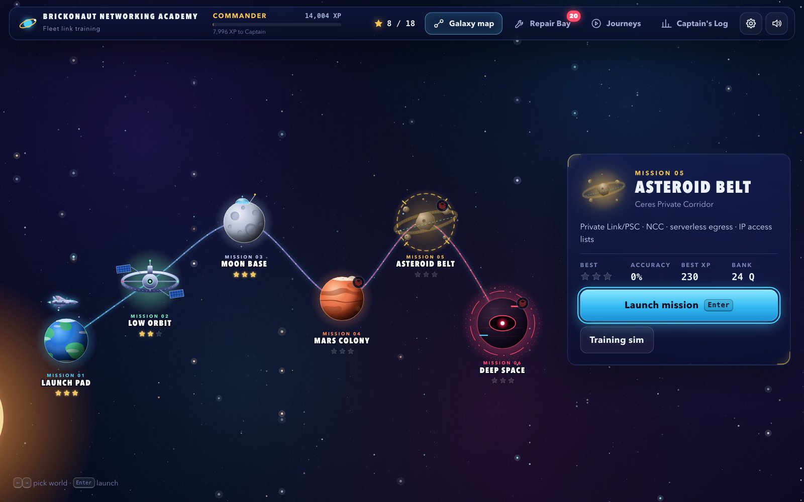
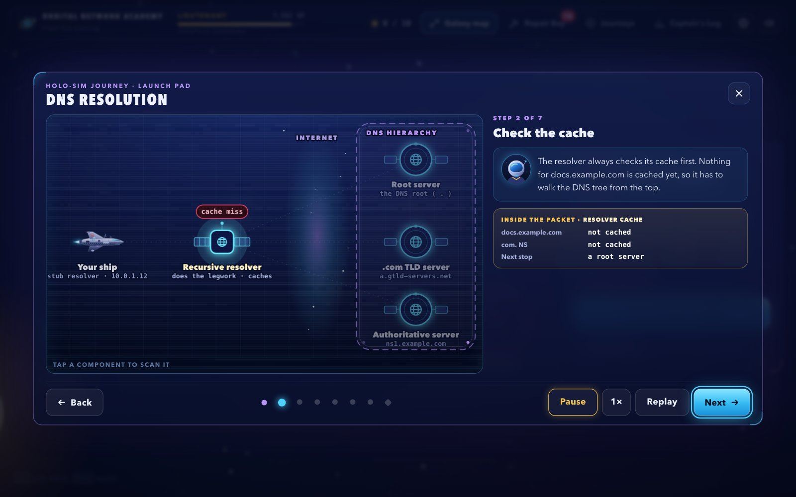

In my first year at Databricks, I've helped many customers through their Databricks onboarding. Some of the most important conversations are about networking: securing how users reach Databricks, keeping compute traffic private, restricting what can leave the network, and making it all work across AWS and Azure.

There's plenty of good documentation. But knowing networking is different from reasoning through it when a firewall rule is wrong and a cluster won't start. So during my ongoing "stay"cation, I used some free time to build a game you can practise with.

**[Brickonaut Networking Academy](https://kritisen.github.io/brickonaut-networking-academy/)** is a space-themed journey. You play a cadet restoring the links of humanity's data fleet after a rogue AI called NULL ROUTE cuts them. Each world is harder than the last:

1. **Launch Pad:** network layers, ports, DNS
2. **Low Orbit:** subnetting math, routing, NAT
3. **Moon Base:** firewalls, TLS, load balancers, VPN and private links between networks
4. **Mars Colony:** the Databricks control plane and compute plane, and sizing your own VPC or VNet
5. **Asteroid Belt:** Private Link, network connectivity configurations, serverless egress control
6. **Deep Space:** boss scenarios where you find the broken hop in a real architecture

## What's inside

- **114 questions:** multiple choice, subnet calculations, putting steps in order, and clicking the faulty part of a diagram. Every Databricks question links to the docs page it's based on.
- **Diagrams:** each question has one, with a short explanation. They open automatically when you get a question wrong.
- **10 Journeys:** animated walkthroughs of how things work, such as a DNS lookup, the TLS handshake, starting a classic cluster, front-end vs. back-end Private Link, and serverless egress.
- **Repair Bay:** questions you miss come back on a spaced-repetition schedule. The **Captain's Log** tracks your accuracy by topic, so you can see where you're weak.
- **Ship, music, phones:** your ship takes damage when you get answers wrong and gets repaired as you learn. There's an ambient soundtrack, and it works on your phone.

👉 **Play it here:** [kritisen.github.io/brickonaut-networking-academy](https://kritisen.github.io/brickonaut-networking-academy/)

It's a personal project, not an official Databricks resource; the docs are always the source of truth. If you find a wrong answer, please tell me. That's part of the fun.
